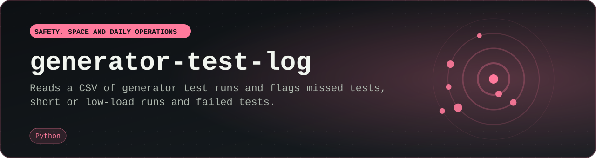
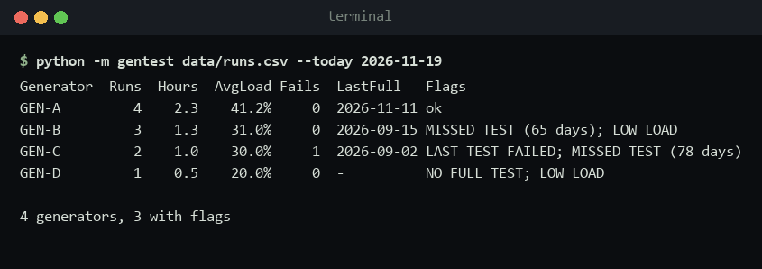

<p align="center"></p>

# generator-test-log

[](https://github.com/yassine2med/generator-test-log/actions/workflows/ci.yml)  

Reads a CSV of generator test runs and flags missed tests, short or low-load runs and failed tests.



## What it is for

Emergency generators must be exercised regularly under real load, and a hospital, data room or office tower needs proof that it happened. A facility manager or building engineer keeps the run log as a CSV. This tool totals runtime and load per generator and shows which generators need attention before an inspector or an outage finds the problem.

## Install

```
git clone <this repo> && cd generator-test-log
python -m pip install -e .
python -m pytest -q
```

## How to use

| I want to | Command |
|---|---|
| Check a run log as of today | `python -m gentest data/runs.csv` |
| Check a run log as of a given date | `python -m gentest data/runs.csv --today 2026-11-19` |
| See the built-in help | `python -m gentest --help` |

Input columns: generator, test_date (YYYY-MM-DD), runtime_min, load_pct (0 to 100), result (pass or fail). The exit code is 2 when any generator has a flag, 1 on bad input, 0 otherwise.

Worked example:

```
python -m gentest data/runs.csv --today 2026-11-19
```

```
Generator  Runs  Hours  AvgLoad Fails  LastFull   Flags
GEN-A         4    2.3    41.2%     0  2026-11-11 ok
GEN-B         3    1.3    31.0%     0  2026-09-15 MISSED TEST (65 days); LOW LOAD
GEN-C         2    1.0    30.0%     1  2026-09-02 LAST TEST FAILED; MISSED TEST (78 days)
GEN-D         1    0.5    20.0%     0  -          NO FULL TEST; LOW LOAD

4 generators, 3 with flags
```

## How it works

- A full test is a passing run of at least 30 minutes at 30 percent load or more.
- MISSED TEST: more than 35 days since the last full test.
- NO FULL TEST: the generator has never had one.
- LAST TEST FAILED: the most recent run by date failed.
- LOW LOAD: a passing run in the last three was below 30 percent load.
- Runs are sorted by date first, so the input order does not matter.
- Bad dates, negative runtimes, load outside 0 to 100, unknown results and missing columns are rejected.

## Limits

- The thresholds are fixed in code and follow a common monthly 30 minute, 30 percent load practice. Check them against your own code and manufacturer rules.
- It does not track fuel level, annual load bank tests or transfer switch tests.
- The sample data is invented.

## License

MIT. Yassine Emhamed, 2026.
